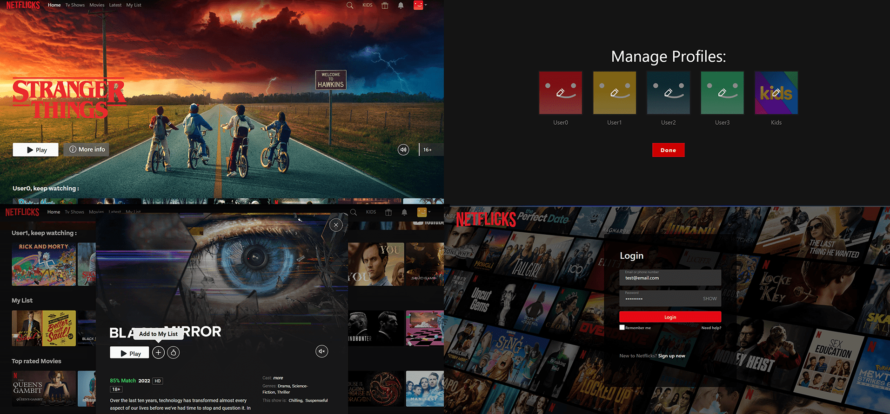

# Angular Netflicks

<p align="center">
  
</p>

A Netflix-inspired educational case study built with Angular, RxJS and Nx. It explores a monorepo structure, reusable UI, routing and lazy loading, with movie and TV data from [TVmaze](https://www.tvmaze.com/api) and [TMDB](https://developer.themoviedb.org/reference/intro/getting-started).

> **Project status: Educational prototype**
>
> Netflicks is a portfolio project for exploring Angular and Nx, not a production streaming service. The home page is the main implemented experience; several other pages and interactions are placeholders or mocks. See [Feature status](#feature-status) for details.

> **Disclaimer:** this project was created **for educational purposes only** and is not affiliated with, sponsored by, or endorsed by Netflix, TV Maze, or TMDB. Netflix and its logos are trademarks of their respective owners. Images, logos, and data belong to their respective owners and are used in compliance with their licenses and terms of use. The author assumes no responsibility for how this code or project may be used by others.

## Preview



<br />

## Live demo
[Netflicks](https://netflicks-6c8b7.web.app)

The demo showcases the implemented UI. Some navigation items and interactions are placeholders; refer to the feature status table below.

## Table of Content
- [Angular Netflicks](#angular-netflicks)
  - [Preview](#preview)
  - [Live demo](#live-demo)
  - [Feature status](#feature-status)
- [Getting Started](#getting-started)
- [Goals](#goals)
- [Stack](#stack)
- [Nx](#nx)
- [Testing](#testing-with-jest)
- [Linting](#linting-with-eslint)
- [Implementation notes](#implementation-notes)
- [Support](#support)
- [License](#license)


## Getting Started

```bash
git clone https://github.com/ac4mm/angular-netflicks.git
cd angular-netflicks
yarn install
yarn start
```

## Goals
The main goal of this project is to explore reactive programming with RxJS and Angular features such as routing and lazy loading, as well as project organization with Nx.

## Feature status

| Feature | Status | Notes |
|---|---|---|
| Home page | Implemented | Main implemented browsing experience |
| Responsive layout | Implemented | The UI is designed to adapt to different screen sizes |
| Routing and lazy loading | Implemented | Used to organize and load application sections |
| TV Shows, Movies, Latest and My List pages | Demo only | Placeholder loading UI; browsing flows are not implemented |
| Search | Mock | The search bar is present, but search is not implemented |
| Kids and Refer Friends | Mock | These links do not provide complete feature flows |
| Notifications | Not implemented | Not available in the current demo |
| TVmaze and TMDB data | Partial | APIs are combined where needed for content and media information |


## Stack
Frontend
- [Angular](https://angular.io/)
- [RxJS](https://rxjs.dev/)
- [Bootstrap](https://getbootstrap.com/)
- [Swiper](https://swiperjs.com/)

API
- [Tv Maze API](https://www.tvmaze.com/api)
- [The movie DB (TMDB)](https://www.themoviedb.org/)

Hosting
- [Firebase](https://firebase.google.com/)

## Nx
### Generate Components

Feature
```bash
nx generate @nx/angular:component [name-feature-component] --project=netflicks --module=feature --path=libs/feature/src/lib --export=true --style=scss

```

Shared
```bash
nx generate @nx/angular:component [name-feature-component] --project=netflicks --module=shared --path=libs/shared/src/lib/components --export=true --style=scss    

```

### Generate Directive with Nx

```bash
nx generate @nx/angular:directive [name-directive] --project=netflicks  --path=libs/shared/src/lib/directive

```

### Generate Library
```bash
nx generate @nx/angular:lib [nameLib]

```

### Lib help options
```
nx g lib --help

```

## Testing with Jest

```bash
yarn test
```

#### For a specific lib
Example
```bash
nx test shared [or feature/netflicks]
```


## Linting with ESLint

```bash
yarn lint
```

## Implementation notes
- TVmaze and TMDB are combined because some information, such as trailers or logos, may not be available from one source.
- Some cover images are combined with logos; depending on the source assets, this can result in duplicated logos.
- Match scores and maturity ratings are generated for demonstration purposes and should not be treated as authoritative information.
- API response models were initially generated with [Quicktype](https://app.quicktype.io/).

## Final considerations
This project is an evolving implementation for learning Angular, RxJS and Nx. It is not intended to provide a complete streaming service.

Feedback, issues, and significant contributions are welcome.

## Support
by [@_ac4mm](https://twitter.com/_ac4mm)

<a href="https://www.buymeacoffee.com/ac4mm" target="_blank"></a>

## License

Distributed under the [MIT License](LICENSE). See the `LICENSE` file for more details.

This product uses the TMDB API but is not endorsed or certified by TMDB. Data from [TV Maze](https://www.tvmaze.com/api) is licensed under CC BY-SA.
